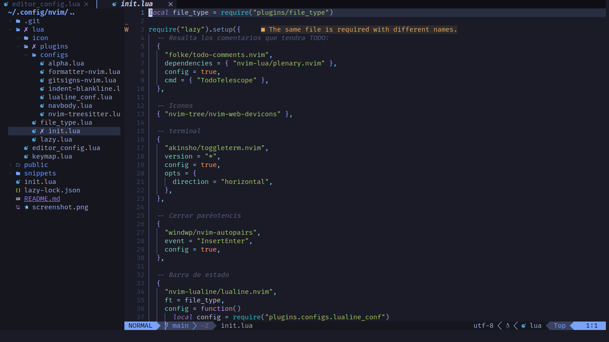

## Dependencias

- git
- ripgrep
- fd
- NerdFont para iconos
- bun (para vtsls y formateo JS/TS)

## Usar en local

1. Clonar el repositorio:

```sh
git clone https://github.com/Lauta-dev/nvim.git ~/.config/lauta_dev_nvim
```

2. Iniciar Neovim con el directorio de configuración:

```bash
NVIM_APPNAME=lauta_dev_nvim nvim
```

> Esto evita que elimine tu configuración existente.

## Arquitectura

La configuración está modularizada en archivos Lua bajo `lua/`:

| archivo | propósito |
| --- | --- |
| `init.lua` | punto de entrada; carga los módulos en orden |
| `lua/plugins/lazy.lua` | instalación y configuración de `lazy.nvim` |
| `lua/plugins/init.lua` | lista de plugins principal |
| `lua/plugins/lsp.lua` | servidores LSP activos |
| `lua/editor_config.lua` | opciones del editor, colorscheme, clipboard, diagnósticos |
| `lua/keymap.lua` | atajos de teclado |
| `lua/autocmd.lua` | autocomandos (yank highlight, restore cursor, etc.) |

## Plugins activos

- **lazy.nvim** — gestor de plugins
- **tokyonight.nvim** — colorscheme
- **mini.comment** — comentarios rápidos
- **mini.statusline** — línea de estado
- **snacks.nvim** — explorer, pickers, terminal, lazygit, notifier
- **blink.cmp** + **friendly-snippets** — autocompletado
- **nvim-treesitter** — resaltado de sintaxis
- **nvim-autopairs** — autosugerencia de pares
- **nvim-web-devicons** — iconos en el file explorer
- **gitsigns.nvim** — indicadores git en el signcolumn
- **mason.nvim** + **mason-lspconfig.nvim** — instalación de LSP y formatters
- **nvim-lspconfig** — configuración de servidores LSP
- **conform.nvim** — formateo
- **nvim-lint** — linters
- **fidget.nvim** — notificaciones progresivas de LSP
- **schemastore.nvim** — esquemas JSON/YAML
- **todo-comments.nvim** — búsqueda de TODOs
- **persisted.nvim** — persistencia de sesiones
- **plenary.nvim** — dependencia de utilidades (usada por todo-comments)

## Servidores LSP configurados

| lenguaje | servidor | observaciones |
| --- | --- | --- |
| go | gopls | |
| typescript / javascript | vtsls | se ejecuta con `bun` para evitar el arranque de Node |
| bash | bashls | |
| lua | lua_ls | |
| html | html | |
| css | cssls | |
| css modules | cssmodules_ls | |
| json | jsonls | con esquemas de schemastore |
| yaml | yamlls | con esquemas de schemastore |
| astro | astro | |
| python | pyright | |
| csharp | omnisharp | configuración específica en `lua/plugins/configs/lsp/csharp_omnisharp.lua` |

## Atajos principales

| tecla | acción |
| --- | --- |
| `<Space>e` | file explorer (snacks) |
| `<Space>ff` | buscar archivos |
| `<Space>fb` | buscar buffers |
| `<Space>fg` | buscar texto (grep) |
| `<Space>fr` | referencias LSP |
| `<Space>fp` | proyectos |
| `<Space>ft` | terminal flotante |
| `<Space>tg` | lazygit |
| `<Space>gd` | ir a definición |
| `<Space>gh` | hover |
| `<Space>sh` | signature help |
| `<Space>ft` | buscar TODOs |
| `fk` | ver todos los atajos |
| `C-s` | guardar |
| `C-x` | guardar y salir |
| `C-q` | salir sin guardar |
| `C-n` | nuevo buffer |
| `C-c` | cerrar buffer |
| `C-d` | ver diagnóstico |
